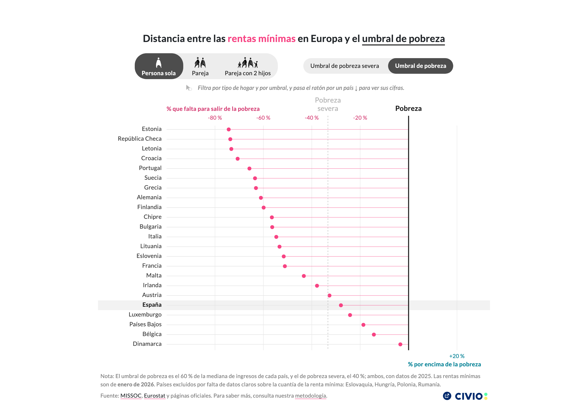

# Rentas mínimas y umbral de pobreza en la UE

Dot chart comparing the maximum minimum-income benefit in 23 EU countries with each country's poverty line (60 % of the median income) or severe poverty line (40 %), for three household types. One row per country, sorted by the distance to the selected threshold: dots to the left fall short, dots to the right go above. A hover/tap tooltip gives the benefit, its programme name and the gap in %. The reader's own country (by IP, optional) is highlighted. Data: MISSOC, Eurostat and official sources, loaded from `data.civio.es`.



## Live preview

**Dataviz URL**: https://graphs.civio.es/lopublico/imv-eu/imv-pobreza-eu/dist

**Investigation URL**: https://civio.es/lo-publico/2026/10/22/las-rentas-minimas-europeas-se-quedan-cortas-ninguna-saca-de-la-pobreza-a-una-persona-sola/

## Stack

- **Framework**: Svelte 5 (runes)
- **Bundler**: Vite
- **Languages**: Spanish, English (`?lang=en`)
- **Other**: D3 (scales, CSV parsing), Playwright (iframe heights)

## Accessibility

Tested with VoiceOver (Safari); Chrome DevTools for the accessibility tree. The SVG is
`aria-hidden` and everything is said in text, in two layers:

- **Fixed layer**, `sr-only`, read once: what the chart is, what a threshold is (the same
  `thresholdNote` string as the visible footnote, which is `aria-hidden` so it is never heard
  twice), and how to read it. The definition opens the description on purpose: on screen the
  footnote is one glance away, by ear it would only arrive after a 23-row table.
- **Live layer**: two `role="status"` regions that are the current state _and_ its announcement,
  so there is no second copy to keep in sync. One before the controls (countries above the
  threshold, Spain household by household, which threshold the table follows) and one right
  below the household filter (the count for the selected household). Written as state, not as
  event («the table covers X», never «the table was updated»), containing only what changes,
  and repeating the threshold noun because they are heard out of context.
- Both regions start `aria-live="off"` and are armed after mount + `tick()`, so loading the data
  and setting the language do not read everything out.
- **Data table** after the chart, following the selected threshold (4 columns), with a
  `<caption>` that names it. Reading order: title → description → state → controls → result →
  table → notes → footer. Each result sits below the control that produces it.
- **Title**: `aria-label` with the plain sentence and the spans `aria-hidden`, because VoiceOver
  reads an element with several children twice, whole and then in pieces.
- **Controls** are real radio groups with per-instance `name`/`id` (`$props.id()`), named with
  nouns («Household type», «Reference value»), not imperatives.
- **Tooltip**: decorative popover on hover (`aria-hidden`, no focus); on touch, a `role="dialog"`
  that takes the focus, closes with Escape and gives the focus back.
- `.viz-root` carries `lang={vizLang.value}`, so the English embed is read with an English voice
  even inside a Spanish page.

Debug modes: `?a11y` paints `sr-only`, `aria-hidden`, `aria-label` and live regions (armed or
muted, `caption-side: top` to match what is heard); `?alt` shows the full description as visible
text, to copy as alt text.

## Development

Requires Node 24 (`.nvmrc`).

```bash
nvm install 24 # if you don't have it
nvm use
npm install
npm run dev
```

## Build

```bash
npm run build
npm run iframe -- --languages=es,en   # responsive iframe snippets in public/iframes/
```

## Embed

```html
<!-- where the chart goes -->
<div class="post-content" style="margin-top: 0; margin-bottom: 0">
  <div class="multimedia full-width" style="margin-top: 0; margin-bottom: 0; padding: 0 5px">
    <div id="imv-pobreza-eu" style="max-width: 800px; margin: 0 auto"></div>
  </div>
</div>

<!-- at the end of the article; add lang="en" to the div above for the English version -->
<script type="text/javascript">
  const dateId = new Date().getTime(); // To avoid cache problems
  var link = document.createElement('link');
  link.rel = 'stylesheet';
  link.href = `https://graphs.civio.es/lopublico/imv-eu/imv-pobreza-eu/dist/assets/index.css?q=${dateId}`;
  document.body.appendChild(link);
  var script = document.createElement('script');
  script.type = 'module';
  script.src = `https://graphs.civio.es/lopublico/imv-eu/imv-pobreza-eu/dist/assets/index.js?q=${dateId}`;
  document.body.appendChild(script);
</script>
```
